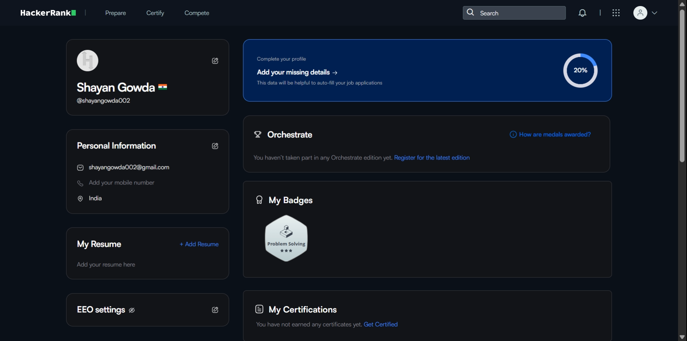
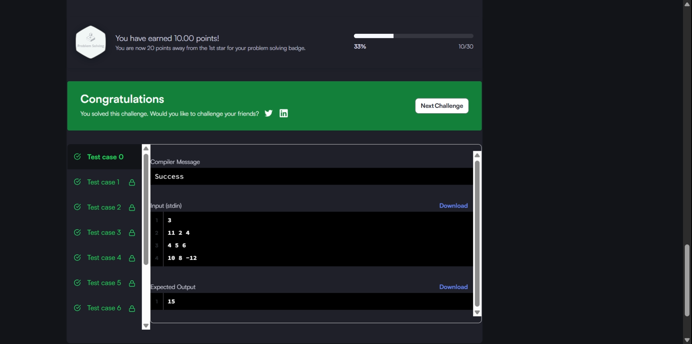
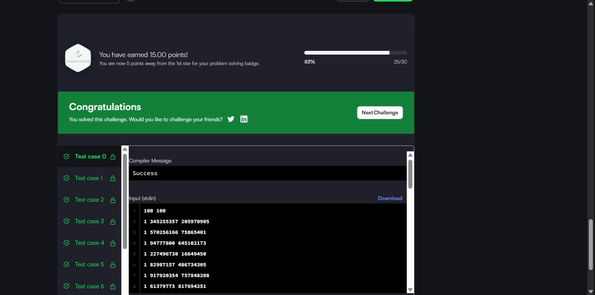
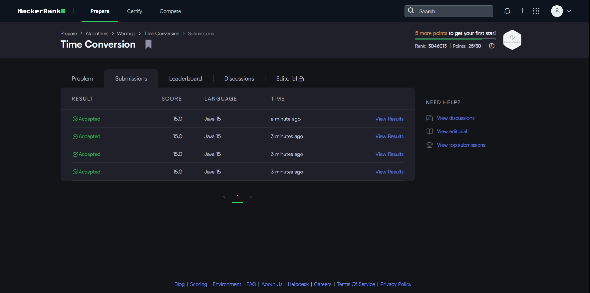
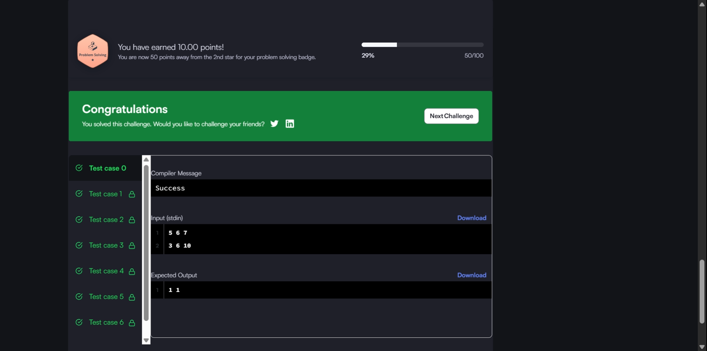
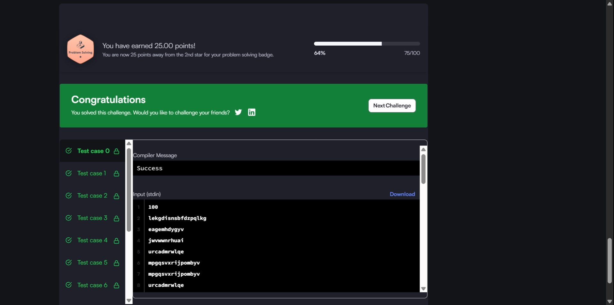
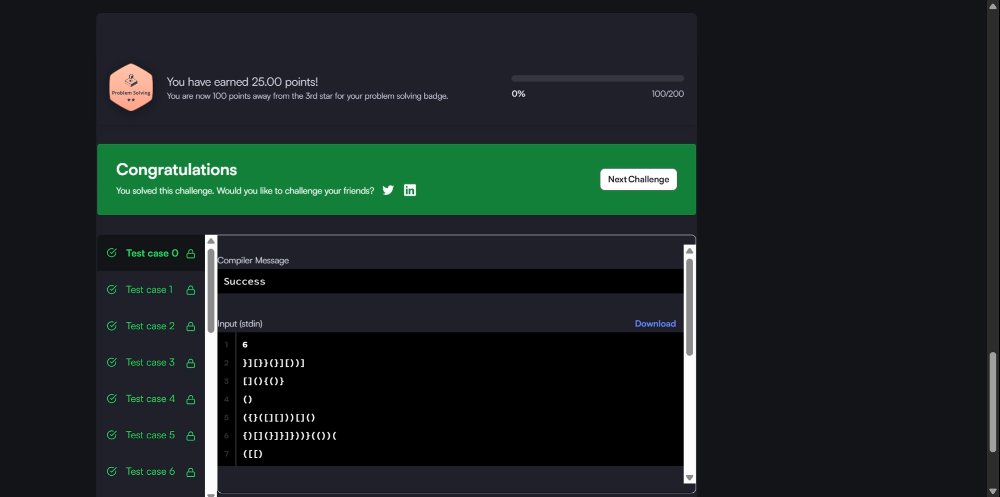

# HackerRank-3rdSem-Portfolio

HackerRank problem-solving practice in Java - part of B25CS0311 portfolio (Activity 8)

**Name:** Shayan D A

**SRN:** R25EF250

**University:** REVA University, B.Tech (3rd Semester)

**Language:** Java

**HackerRank profile:** [shayangowda002](https://www.hackerrank.com/profile/shayangowda002)

## Badge earned

3-Star Problem Solving badge on HackerRank:

## Problems and complexity analysis

| # | Problem | Topic | Time | Space | Code |
| --- | --- | --- | --- | --- | --- |
| 1 | Diagonal Difference | 2D Arrays / Matrices | O(N) | O(1) | [Solution](01-diagonal-difference/Solution.java) |
| 2 | Dynamic Array | Data Structures / Vectors | O(N + Q) | O(N) | [Solution](02-dynamic-array/Solution.java) |
| 3 | Time Conversion | Strings and Logic | O(1) | O(1) | [Solution](03-time-conversion/Solution.java) |
| 4 | Compare the Triplets | Basic Implementation | O(1) | O(1) | [Solution](04-compare-the-triplets/Solution.java) |
| 5 | Sparse Arrays | Hash Maps / Strings | O(N + Q) | O(N) | [Solution](05-sparse-arrays/Solution.java) |
| 6 | Balanced Brackets (extra) | Stacks | O(N) | O(N) | [Solution](06-balanced-brackets/Solution.java) |

Every Solution.java has a local test helper in main with typical and edge cases, and the HackerRank method is pasted into the Result class on the site.

## Accepted submissions

### 1. Diagonal Difference

### 2. Dynamic Array

### 3. Time Conversion

### 4. Compare the Triplets

### 5. Sparse Arrays

### 6. Balanced Brackets (extra)

## More practice for the badge

To reach the 3-star badge I also solved Equal Stacks, Mark and Toys, Max Min and Find the Median on HackerRank. Their solutions are not in this repository.